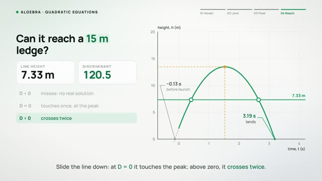
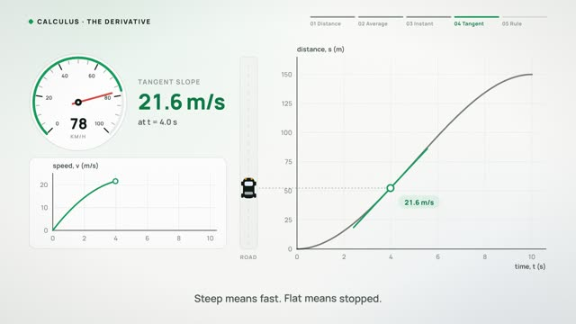
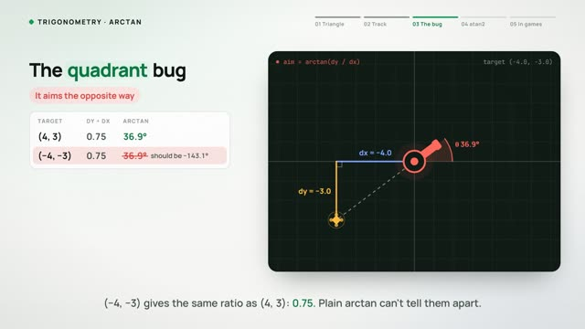
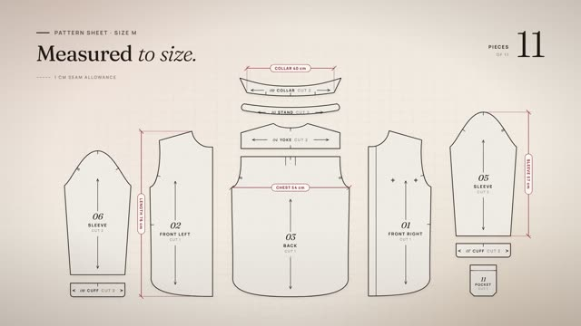
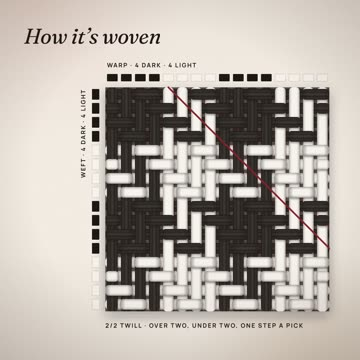
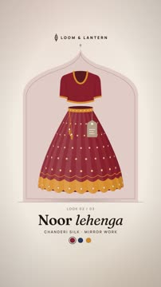

# Motion graphics in code

2D motion graphics and animated explainers, built with [Remotion](https://www.remotion.dev), React and TypeScript. Six pieces, one shared component kit, and the tooling to render, check and publish them.

**Watch them:** [the portfolio page](https://kpyrbot.duckdns.org) · by [Kordor Pyrbot](https://github.com/Darkboy17)

| | Piece | Format | What it shows |
| --- | --- | --- | --- |
|  | **Where does a thrown ball land?**<br>Algebra: quadratic equations | 16:9, 1:14 | A throw becomes the graph of h(t). The quadratic formula gives the landing time, the vertex gives the peak, and the discriminant says whether the ball can reach a ledge. |
|  | **What does a speedometer measure?**<br>Calculus: the derivative | 16:9, 1:23 | Secants shrink to a tangent as the average speed settles on the instant speed, then a sliding tangent drives a live speedometer. |
|  | **How does a game turret aim?**<br>Trigonometry: arctan and atan2 | 16:9, 1:23 | A turret aims with arctan(dy/dx) until the target goes left and it aims backwards. atan2 fixes it, and homing missiles put it to work. |
|  | **Anatomy of a Shirt**<br>Fashion: technical flat | 16:9, 0:36 | A shirt drawn as a technical flat comes apart into 11 pattern pieces, is measured, and is sewn back together seam by seam, then changes cloth on the beat. |
|  | **Houndstooth**<br>Fashion: textile study | 1:1, 0:24 | How houndstooth is woven: an 8 × 8 repeat, a field, then the threads of a 2/2 twill relaxing back into the pattern. It loops. |
|  | **The Festive Edit**<br>Fashion: collection-drop reel | 9:16, 0:22 | A collection-drop reel for a fictional label, cut on a 120 BPM beat: split-flap date, three looks drawn on, colour story, end card. |

## Run it

```bash
npm ci
npm run dev                 # Remotion Studio: every piece, scrubbable, with editable props
npm run render              # masters, web encodes, posters and captions in out/
npm run showreel && npm run site   # the portfolio page in site/dist
npm test                    # unit tests for the maths and models
```

Needs Node 22 and ffmpeg. Remotion fetches its own headless Chrome the first time it renders.

Or with only Docker:

```bash
docker build -t motion-portfolio .            # renders every piece inside Docker and serves the page
docker run -p 8080:80 motion-portfolio        # http://localhost:8080
```

## How the repo is laid out

```
src/
  kit/            the shared video kit: tokens, motion, text, diagrams, charts, maths, code, media
  videos/<slug>/  one folder per piece: timeline.ts (beat sheet), model.ts (maths, tested), scenes
  entries/        one Remotion entry per piece, so each renders on its own
  Root.tsx        every composition, for Remotion Studio
scripts/          sound and Lottie generators, render, showreel and site builders
public/           synthesized sound and authored Lottie files
site/             the portfolio page
```

## The kit

Everything a piece needs to look consistent lives in `src/kit/`, and every piece uses it.

- **Tokens** (`theme.ts`): two palettes (`lab` for explainers, `atelier` for fashion), type, easing curves and spring presets. Components never inline a colour or a curve.
- **Motion** (`motion.ts`, `Enter.tsx`): `useSec()` turns seconds into frames, `tween()` is eased and clamped, and `Enter`/`Stagger`/`ExitAt` give every entrance three properties and a quicker exit.
- **Layout** (`Stage.tsx`, `Explainer.tsx`): the layered stage (background, content, grade, grain, vignette), the explainer text column, chapter titles, hook titles and recap rows.
- **Text and captions** (`Text.tsx`, `Captions.tsx`, `cues.ts`): word reveals with `*emphasis*` markup, and burned-in captions whose cues also export as WebVTT.
- **Diagrams and charts** (`Diagram.tsx`, `Graph.tsx`): paths that draw on, arrows, callouts and angle arcs; a `Graph` that gives its children scales, so plots are written in graph units.
- **Maths** (`Eq.tsx`, `math.ts`): equations built from spans so each term can enter or light up; pure helpers for roots, slopes and angles, with tests.
- **Readouts** (`Widgets.tsx`, `CodeBlock.tsx`): gauge, counter, pill, panel, chapter bar, and a code block with typing and line focus.
- **Media** (`Media.tsx`): sound effects placed on their frame, music beds, and Lottie clips recoloured to the theme.

`KitGallery` renders every component in one sheet.

## How a piece is made

1. **Beat sheet.** `timeline.ts` lists each beat in seconds. Animations, captions and sounds all key off it, so retiming a beat is a one-line change.
2. **Model.** The maths or data behind the piece is a set of pure functions with unit tests. Nothing on screen is typed in by hand: the quadratic explainer re-derives every number from three props, which Remotion Studio exposes through a zod schema.
3. **Scenes.** Built from kit components, with anything piece-specific kept in the piece's folder.
4. **Look at it.** Render stills at every beat, look at each one, fix, re-render. Then a full render, and frames pulled from the MP4 to check the encode.

## Deployment

Every push to `main` runs [`.github/workflows/ci-cd.yml`](.github/workflows/ci-cd.yml):

1. **Check**: lint, typecheck, unit tests, the asset generators, and one rendered still per piece (pull requests stop here).
2. **Render and build the image**: earlier renders come back from the Actions cache, and `npm run render -- --changed` re-renders only the pieces whose source changed. Then the showreel and page are built and the nginx image is pushed to `ghcr.io/darkboy17/motion-portfolio`, tagged with the commit.
3. **Deploy**: over SSH, the Oracle VM pulls that image and restarts two containers on one Docker network ([`deploy/remote-deploy.sh`](deploy/remote-deploy.sh)): the nginx site, which isn't exposed, and [Caddy](deploy/Caddyfile) on ports 80 and 443, which keeps a Let's Encrypt certificate for the domain, redirects HTTP (and the bare IP) to HTTPS, and forwards requests to the site. The job then checks `/healthz` over HTTPS from outside.

The repository needs three variables (`VM_HOST`, `VM_USER`, `SITE_DOMAIN`) and two secrets (`VM_SSH_KEY`, a key used only for deploys, and `VM_KNOWN_HOSTS`). To roll back, run the deploy script with an earlier commit's tag.

## Assets and licences

Fonts are from Google Fonts (SIL Open Font License). Every sound is synthesized by `scripts/make-sfx.ts`, and every Lottie file is written by `scripts/make-lottie.ts`. Illustrations are SVG drawn in code. [ASSETS.md](ASSETS.md) lists each file with its source and licence, with a ready table for stock items (Envato Elements, LottieFiles) when they are used.

## Working on it

See [CONTRIBUTING.md](CONTRIBUTING.md): one piece or kit change per pull request, Conventional Commits, and stills attached to every PR. CI runs lint, typecheck, tests, the asset generators, and a rendered still from every piece.

## Licence

Code and original assets: [MIT](LICENSE), © 2026 Kordor Pyrbot. Fonts keep their own licence (SIL OFL 1.1).
